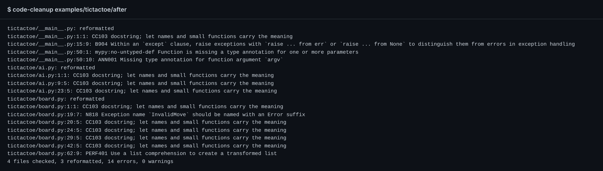
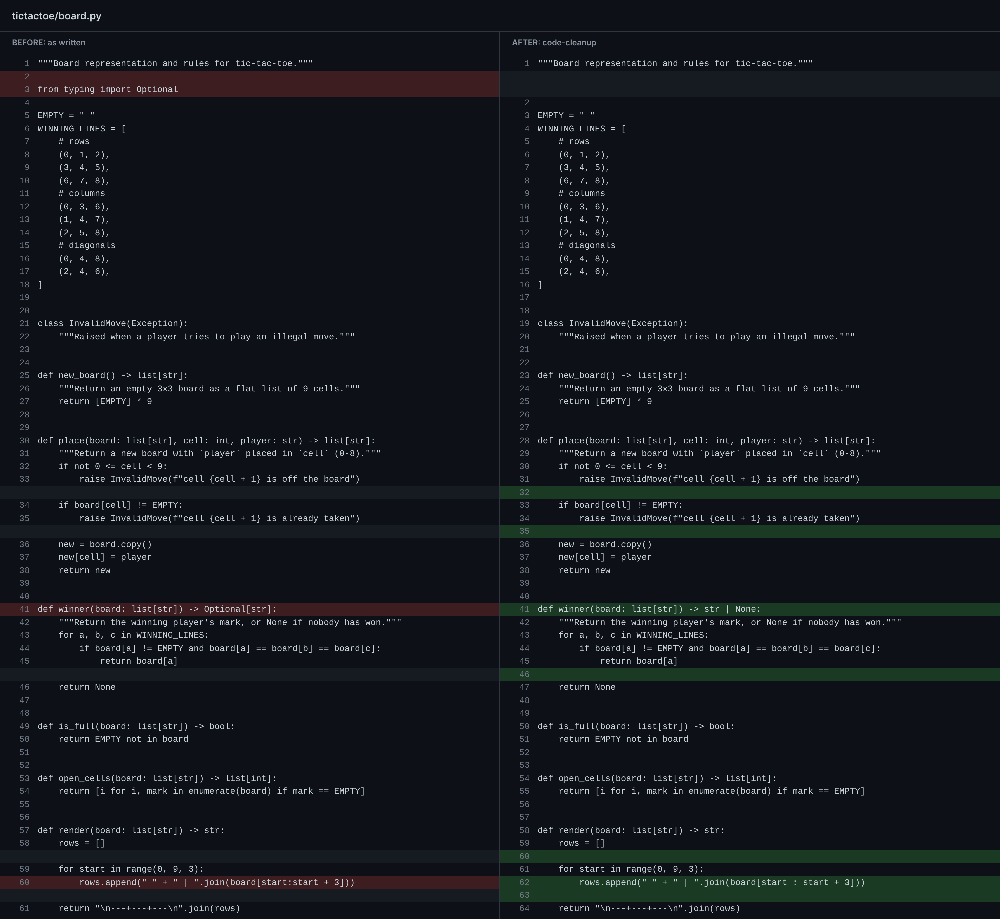
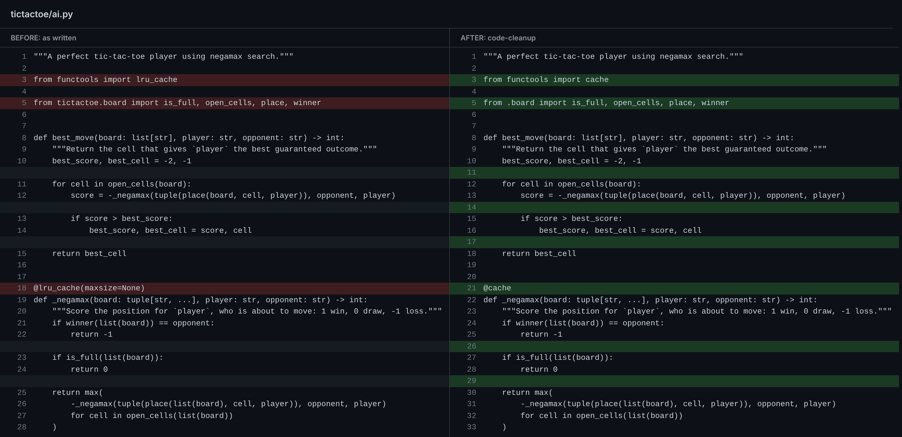
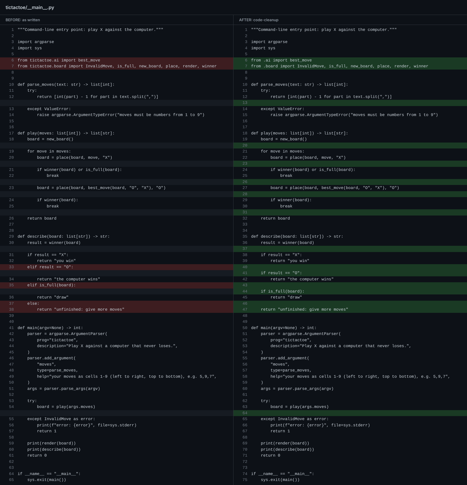

# Example: tic-tac-toe, before and after

A small game: you play X from the command line against a computer that searches
every move (negamax) and never loses.

```sh
cd examples/tictactoe/after
python -m tictactoe 1,2,7,6,9
```

```
 X | X | O
---+---+---
 O | O | X
---+---+---
 X | O | X
draw
```

- `before/` is the code as first written: ordinary Python, not made messy on purpose.
- `after/` is `before/` after one run of `code-cleanup`, unedited.

`code_cleanup/tests/test_main.py` cleans a copy of `before/` and checks that it
matches `after/` byte for byte, so this example always shows what the tool really
does. Both versions play identical games.

## The run



The tool fixed what is safe to fix and listed the rest for a person to decide:

| Code | What it wants | Why it was not fixed automatically |
|---|---|---|
| `CC103` | no docstrings: names and small functions carry the meaning | deleting prose is a person's call |
| `B904` | `raise ... from error` inside `except` | changes the traceback, so a person chooses |
| `ANN001`, `mypy:no-untyped-def` | a type for `argv` (ruff and mypy both see it) | the tool cannot know the intended type |
| `PERF401` | `render` builds `rows` with a comprehension, not an append loop | ruff marks this rewrite unsafe, so it only reports it |
| `N818` | `InvalidMove` renamed `InvalidMoveError` | a rename touches every caller |

## What changed

### `board.py`

- `Optional[str]` became `str | None`, and the unused `typing` import went.
- Blank lines around every block, slice spacing from `ruff format`.
- `WINNING_LINES` is untouched: its group comments sit on their own lines, which
  `ruff format` keeps. (A first draft put them at the end of lines holding three
  tuples each; the formatter split those lines and left each comment on one tuple.)



### `ai.py`

- `from tictactoe.board import ...` became `from .board import ...`.
- `@lru_cache(maxsize=None)` became `@cache`.
- Blank lines around blocks. A docstring counts as part of the function header, so
  no blank line is added between it and the first `if`.



### `__main__.py`

- `from tictactoe.ai` / `from tictactoe.board` became `from .ai` / `from .board`.
- `if` / `elif` / `else` chains that all `return` became flat `if` guards.
- Blank lines around blocks and between `try` and `except`.


